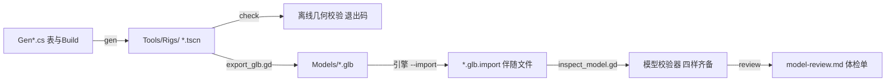

# BeastArena 造型资产管线 — 材质库 · 共享骨架 · 导入检查 · 一条命令体检

> 本文是开发期工位的操作说明与事实记录，不新立约束句（「约束唯一出处」）；
> 约束按名字引用：「真模型」「模型四件套」「资产可重跑」「伴随文件入库」「造型进模型」。
> 公共层机制的出处见 `docs/模型与动画准则.md`；本文只写 BeastArena 这一家怎么用这条管线。

## 管线总览



产物落点：源场景 `src/Prototypes/BeastArena/Tools/Rigs/`，模型 `src/Prototypes/BeastArena/Models/`，
开发期产物根 `.cache/`（唯一出处 `src/Tools/Artifacts.cs`，「临时工程归 .cache」）。

## 1. 生成器按域拆分（T09）

`Gen.cs` 与三个同伴文件都是同一个 `public static partial class Gen`：

| 文件 | 管什么 | 谁在并行改它（T10–T14） |
| --- | --- | --- |
| `Tools/Gen.cs` | 配色表 Mat、目录表 PathDef、放大档 Fits、Emit()、Gable()、Run() 构建顺序 | 只加行，不挪人 |
| `Tools/Gen.Units.cs` | 巨兽三形态 + 地面人形六件（居民四件 + 原生怪两件） | T10、T12 |
| `Tools/Gen.Town.cs` | 十三件建筑 + 城齿助手 Crenels() | T11 |
| `Tools/Gen.Deck.cs` | 磁悬浮底座与镇地面 | T10 |
| `Tools/Gen.Props.cs` | 浮桥 / 空艇 / 尸体 / 货物 / 城 / 食物点等地物件 | T13、T14 |
| `Tools/Gen.World.cs` | 大地图世界域（T14）：两种树 / 矿石 / 兽群 / 魔晶 / 远方高塔 / 两层地下五件套 | T14 |

拆分硬判据：拆分后 `gen` + `export` + `import` 重跑，全部 `.glb` 与拆分前 SHA256 逐字节相同。
对比证据：`.cache/beast-arena-vs/T09/glb-before-split.sha256` 与 `glb-after-split.sha256`（diff 为空），
`.tscn` 同目录两份。`Run()` 的构建顺序一字未动。

## 2. 材质库（配色表 Mat 的唯一出处：`Tools/Gen.cs`）

画面基准（spec「10.1 画面基准」）：暖陶砖、象牙色、蓝灰屋顶、冷暗巨兽；青色只用于少量魔法发光。
下表按六类给「材质名 → 用途」。T09 新增两个 key：`brick`、`slab`。
没被任何 `Build*()` 引用的 key 不会写进 `.tscn` 与 `.glb`——加 key 不改任何现有模型字节。

| 类别 | 材质名 | 用途 |
| --- | --- | --- |
| 砖 | `brick` | 暖陶砖墙（维多利亚砖墙；T09 新登记，待 T11/T13 建筑换墙用料） |
| 砖（屋顶面） | `roofRed` | 陡坡红屋顶片；`clothRed` 是同一档红布的衣物用法 |
| 石板 | `slab` | 蓝灰铺地石板（T09 新登记，待 T13 道路与广场） |
| 岩石 | `stoneL` | 象牙色岩面：塔身、教堂中殿、井台 |
| 岩石 | `stoneM` / `stoneD` | 中灰台基与底座；深灰岩体（浮山岩层、城 rockA）；钻地怪的背甲、头板与前臂护甲 |
| 岩石（地貌） | `dirt` / `sand` / `crop` | 泥地、沙地斗场、麦田与粮袋 |
| 木材 | `woodL` / `woodD` | 亮木墙板与家具 / 暗木结构柱梁与柴垛 |
| 木材（甲板） | `deckWood` | 甲板与浮桥面板 |
| 木材（顶棚） | `thatch` | 茅草顶、草靶、干草堆 |
| 兽皮 | `hide` / `hideD` | 巨兽基础厚皮与深色鬃尾 |
| 兽皮（形态） | `hideSand` / `hideSandD` / `hideDark` / `hideDarkD` | 荒漠态沙色皮、暴食态深色皮（三形态配色唯一区分项） |
| 兽皮（角质） | `horn` / `hoof` / `bone` | 角、铁蹄、骨角与怪鬃 |
| 皮革 | `leather` / `leatherD` | 围裙、皮带、盾柄、箭袋 |
| 旧铜 | `bronze` | 旧铜器：角斗士铜盔与护肩、镇公所塔顶 |
| 金属（亮） | `gold` | 亮金火盆 |
| 金属（铁件） | `iron` / `steel` | 铁箍与炉口楣梁 / 钢材刃尖 |
| 布 | `cloth` / `clothBlue` / `clothGreen` / `canvas` | 深色布巾 / 镇民外套与旗 / 旅店招牌 / 空艇气囊与篷 |
| 皮肤 | `skin` | 人形裸露皮肤 |
| 屋顶 | `roofBlue` / `roofGreen` | 陡坡蓝灰屋顶（教堂、法阵井棚）/ 绿顶（酒馆） |
| 发光 | `glowGold` / `glowFire` / `glowWarm` | 小立面发光：火盆、炉口、窗与灯 |
| 发光（平面） | `glowDim` / `glowAmber` | 长条暗光边 / 朝上大平面能量圈（防过曝两档，原因见 Gen.cs 注释） |
| 发光（魔法） | `glowCyan` | 青色魔法发光（T11 登记）：魔晶小件与传送残晶；T14 的魔晶本体、洞口腔内那一抹与嵌入构件光环同用这一 key —— 画面基准里「青色只用于少量魔法发光」那一格 |
| 水 | `water` | 井水（唯一冷色非发光件） |

同档重复的处置：`clothRed` 与 `roofRed` 是同一档红的两种用途（布与屋顶），
`stoneM` 与 `slab` 是岩石与石板两种板材——**表里合并口径、代码里不并 key**：
并 key 会改已入库 `.glb` 的材质名段字节，与「不改任何现有模型字节」冲突。新增模型按上表选名，不再造档。

## 3. 共享骨架（人形一副、巨兽一副）

| 骨架 | 骨名（逐字） | 动作库 | 挂了它的模型 |
| --- | --- | --- | --- |
| 人形 | `root, hips, spine, chest, neck, head, shoulderL/R, armL/R, handL/R, thighL/R, shinL/R, footL/R`（18 根） | `src/GugaFramework/Tools/glb/clips_humanoid.gd` | 居民四件 `Citizen` `Gladiator` `Helper` `Worker` 带八条（idle / walk / run / attack_melee / hit / death / work / carry）；原生怪两件 `Monster` `MonsterBurrower` 带七条（idle / walk / run / attack_melee / hit / death / emerge） |
| 巨兽四足 | `m_root, m_hips, m_spine, m_chest, m_neck, m_head, m_legFL/FR/BL/BR, m_kneeFL/FR/BL/BR, m_hoofFL/FR/BL/BR, m_saddle, m_tail`（20 根，`m_` 前缀防撞名） | `src/GugaFramework/Tools/glb/clips_beast.gd` | `Beast` `BeastDesert` `BeastGlutton` `BeastTier2` `BeastDesertTier2` `BeastGluttonTier2`（六件都挂这同一副 20 骨骨架，骨名六件一字不差） |

自动化检查（不起引擎、读 `.glb` 的 JSON 段）：`src/Prototypes/BeastArena/Tests/SharedSkeletonTests.cs` 四条——
同组蒙皮关节名数组逐字相同（人形骨架按居民四件 / 原生怪两件两组各判，关节名七件一致）；
同组每条 clip 的轨道目标骨都落在组内每个模型的骨架里（「同一 clip 能套两个模型」的机器判据）；
组内 clip 名单一致（居民组八条、原生怪组七条各自成组）；两副骨架骨名互不重叠。
跑法：`dotnet test src/Prototypes/BeastArena/Tests --filter FullyQualifiedName~SharedSkeletonTests`。

动作复用样本证据（引擎工位，数字口径）：`.cache/beast-arena-vs/T09/action-reuse.md`——
`Worker` 与 `Citizen` 的 `idle` / `walk` / `run` 与 `Beast` 与 `BeastDesert` 的 `idle` / `walk` / `run`，
同一 clip 在两个模型上的最大骨偏移与名义时长逐条并排。

## 4. 导入检查：四样齐备（模型四件套的机器判据）

实现只有一个出处：`src/GugaFramework/Tools/glb/model_metrics.gd` 的 `measure()` + `judge()`；
校验器 `inspect_model.gd` 与体检单 `review/review_capture.gd` 共用同一份（「校验器与报告共用一次计算」）。

| 一样 | 读什么 | 缺了判什么 |
| --- | --- | --- |
| 顶点数据 | `Body` 网格逐面 `surface_get_array_len` 求和 | `没有 Body 网格` / `没有顶点数据（Body 网格 0 顶点）` |
| 骨架 | `Skeleton3D` 骨数 | `没有骨架（Skeleton3D 骨数 0）` |
| 蒙皮 | `Body` 的 `skin` 绑定数（4.7 挂在 MeshInstance3D 上，引擎事实 1） | `没有蒙皮（Body 的 skin 绑定为空）` |
| 动作 clip | `AnimationPlayer` 名单对契约 `NeedClips`，逐条量最大骨偏移 > 2 毫米 | `缺动作 X` / `动作 X 没有让任何骨离开绑定姿势` |

静态件（建筑与道具）按契约只判顶点数据，骨架/蒙皮/clip 三项跳过——判定口径在 `judge()` 的 `static` 分支。
88 件现役模型四样全齐：本次 `verify` 全 PASS，数字见 `model-review.md`。

## 5. 一条命令体检

```
dotnet run --project src/Tools -- check BeastArena .
```

只读 `.tscn`、不起引擎，判占地与悬空件（`Tools/Check.cs`）。
`.glb` 侧的回读校验（四样 + 占地 + clip 名单）原来要单独拼第 5 步的引擎命令，两步才出结论——
T09 在 `Tools/BeastArenaTools.cs` 注册了薄封装动词 `verify`，只转发第 2 格与第 5 格两个既有校验器，不重算：

```
dotnet run --project src/Tools -- verify BeastArena .
```

前提：`Models/` 里 `.glb` 与 `.glb.import` 都在（第 3、4 步已跑）。
缺第 4 步时报 `Cannot open file 'res://.godot/imported/…'`——那是资源没进过导入，不是造型不合格（「造型线六步」坑 1）。
引擎定位：`--godot=<exe>` 或环境变量 `GODOT_BIN`（三级找法 `src/Tools/GodotBin.cs`）。

## 6. 新增一个模型要走哪几步

前提：`GODOT_BIN` 指向 Godot 4.7.2-stable mono（本项目实测用控制台版 exe）。

1. 在对应域的 partial 文件加一个 `Build<Name>()`（域表见第 1 节）；配色从 `Tools/Gen.cs` 的 Mat 表里选名。
2. `Tools/Gen.cs` 的 `Run()` 列表**末尾**加一行调用；`Fits` 表按需加一档放大（人形配套按 1.0，不加大）。
3. `Tools/Uids.cs` 加一行 uid。
4. `Tools/ExportModels.gd` 的 `models()` **末尾**加一行。静态件不写 `clips`；
   会动的按骨架选库：人形 `GROUND_HUMANOID`、巨兽 `{ lib = "beast", clips = LOCOMOTION }`。
   原因：`_PhysicalBoneSimulator3D_<n>` 的序号按导出顺序数，插在表中间会改后面每一件 `.glb` 的字节。
5. `Tools/BeastArenaTools.cs` 的 `Review().Models` 加名字。四处一起动，漏一边导不出。
6. 生成与验收，按序跑：

```
dotnet run --project src/Tools -- gen BeastArena .
dotnet run --project src/Tools -- check BeastArena .
"$GODOT_BIN" --headless --path . --quit-after 1800 \
  --script res://src/GugaFramework/Tools/glb/export_glb.gd -- --proto=BeastArena
"$GODOT_BIN" --headless --path . --import
dotnet run --project src/Tools -- verify BeastArena .
dotnet run --project src/Tools -- review BeastArena .
dotnet test src/Prototypes/BeastArena/Tests
```

7. 会动的新模型还要加测试：`Tests/SharedSkeletonTests.cs` 的组名单里加名字（骨名逐字一致才能复用动作组）。
8. 结论与数字回写本文与 `model-review.md`（后者由 `review` 生成，勿手改）。

## 7. 相关测试

| 测试 | 挡什么 |
| --- | --- |
| `Tests/AssetSourceGuardTests.cs` | 动作库与导出器在不在版本库里、每个 `.glb` 的 `.import` 伴随文件带 uid（「伴随文件入库」「资产可重跑」） |
| `Tests/SharedSkeletonTests.cs` | 两副共享骨架骨名逐字相同、clip 可跨模型复用（本文第 3 节） |
